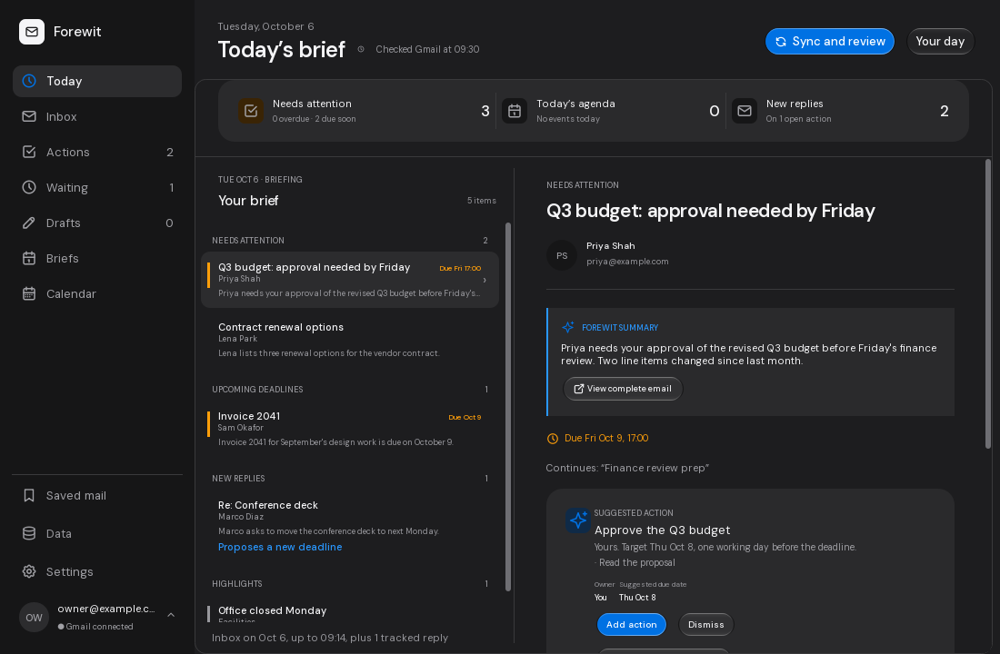

# MailBrief

MailBrief is a personal desktop app for Windows and macOS that turns important
Gmail messages into a short daily brief with summaries, suggested actions and
deadlines. Review the messages you want it to read, then choose whether to send
their prepared text to Groq for AI analysis.

**[Download for Windows (ZIP build)](https://github.com/Coins99/MailBrief/actions/workflows/ci.yml)**

Choose the latest successful **main** build and download its Windows artifact.
GitHub sign-in is required. [Download and launch instructions](#windows-download-extract-and-run).

## What you can do

- Review ranked Inbox messages and open the originals in Gmail.
- Keep track of actions, plans, target dates and follow-up replies.
- Keep your own calendar events beside your open actions' deadlines and target dates,
  and see your Google Calendar there too, read-only ([Calendar](docs/calendar.md)).
- Write local drafts and notes, with optional AI drafting from context you choose.
- Browse saved briefs and cached mail metadata offline.
- Set your time zone, sender exclusions and refresh preferences.
- Back up and restore local data, and export your writing.

Gmail is the active mailbox provider, with read-only access. MailBrief does not
send mail or change your mailbox; drafts stay local until you copy or export them.
Outlook support is retained in the codebase for later work.

**Status:** this is a personal-use project under development. Features are
implemented, but live-account and packaged-app acceptance checks remain open.
See [project status](docs/project-status.md) for the milestone record and
[platform acceptance](docs/m5-acceptance.md) for outstanding checks.

## Get started

### Windows: download, extract and run

1. Open [MailBrief's CI builds](https://github.com/Coins99/MailBrief/actions/workflows/ci.yml)
   and choose the latest successful run on **main**.
2. Under **Artifacts**, download **MailBrief-Windows-onefile-...**. GitHub
   requires you to sign in to download build artifacts.
3. Right-click the downloaded ZIP and choose **Extract All**.
4. Open the extracted folder and double-click **MailBrief.exe**. Allow a few
   seconds for the window to appear, then follow the Gmail and AI setup below.

The EXE includes Python and all application dependencies. No separate Python,
uv or Git installation is needed. GitHub's **Code > Download ZIP** contains the
source code; use the build artifact above to get the runnable app.

Windows build artifacts are kept for three days. These are development builds;
when a release is published, it will appear on the
[Releases page](https://github.com/Coins99/MailBrief/releases).
The current Windows package targets Windows 11 x64. See
[Windows executable instructions](docs/windows-executable.md) for updates and
saved-data details.

For macOS packages, see [desktop packaging](docs/m5-desktop.md#build-and-check-packages).
To run from source or build your own package, see the [contributor guide](CONTRIBUTING.md).

### Connect Gmail and set up AI

Configured builds let you choose **Sign in with Google** directly and automatically
sync your full current Inbox. The **Inbox** page shows metadata across all received dates;
daily briefs still cover today's mail. Custom OAuth files are optional in these builds.
See [Google sign-in and Inbox](docs/google-signin-inbox.md) for developer configuration
and details. The manual setup below applies to development builds without bundled sign-in.

1. Follow [Gmail setup](docs/gmail-setup.md) to enable the Gmail API and download
   a Google **Desktop app** OAuth client JSON file. Keep that file outside the
   repository in a stable location; MailBrief saves its path.
2. Open **Settings** in MailBrief, select the OAuth file and save it. Choose
   **Connect Gmail** and complete sign-in in your browser.
3. For AI summaries or drafting, follow [AI setup](docs/ai-analysis.md#setup),
   then save your Groq model and API key in **Settings**. Enable Groq Zero Data
   Retention before sending private mail.
4. Choose **Sync and review**. Select the messages MailBrief may read, then
   approve or decline sending their prepared text to Groq.

You can view saved briefs and cached metadata offline. New AI summaries and AI
drafting need a configured Groq key and your approval. Automatic analysis needs
separate explicit permission in the app.

## Your data

MailBrief stores cached metadata, saved briefs, actions, drafts, calendar events and
preferences locally in SQLite. Gmail tokens and Groq keys use Windows Credential
Manager or macOS Keychain. Downloaded incoming email bodies are prepared in memory
rather than saved as a body cache.

AI processing happens on Groq's servers. You review the messages or drafting
context and approve sending it; local storage does not make AI processing local. See
[AI analysis and consent](docs/ai-analysis.md) and
[AI drafting](docs/m7-drafts.md) for the data sent in each workflow.
Use **Data** in the sidebar for backup, export and recovery; see
[data and recovery](docs/m9-durability.md).

## Contributing

Bug reports, documentation improvements and focused pull requests are welcome.
See the [contributor guide](CONTRIBUTING.md) for source setup, package builds,
checks and pull request guidance.

## Further reading

- [Desktop usage and keyboard navigation](docs/m5-desktop.md)
- [Actions and plans](docs/m6-actions.md)
- [Manual tasks and activity history](docs/p1-manual-tasks.md)
- [Drafts, notes and AI writing](docs/m7-drafts.md)
- [Preferences, brief history and daily operation](docs/m8-daily-operation.md)
- [Project status and milestone documentation](docs/project-status.md)
- [Scope](docs/mvp-scope.md) and [implementation plan](docs/email-implementation-plan.md)
- [Architecture decisions](docs/adr/)
- [Future planner feature inventory](docs/future-feature-inventory.md) and
  [researched implementation plan](docs/future-implementations.md)

## License

MailBrief is licensed under the [MIT License](LICENSE). Bundled fonts and icons
have their own notices included with desktop packages.
