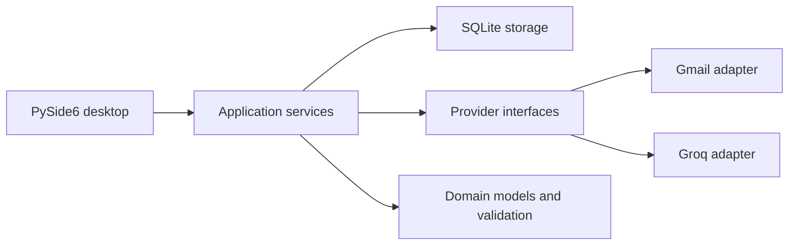

# Engineering tour

Forewit is a personal desktop planner that brings email briefs, tasks, notes and calendar planning into one application. This guide gives a reviewer a route through the code and the decisions behind it.

**Stack:** Python 3.13, PySide6, SQLite, SQLAlchemy, Alembic, Pydantic, httpx and uv. The public product is Forewit; imports, distribution metadata and compatibility commands retain `mailbrief`.

## Architecture at a glance

This is a high-level view of the active application, not every module. Gmail is the active mail provider; Microsoft code is retained but dormant. Local AI is experimental and disabled by default.

| Area | Where to look | What to inspect |
| --- | --- | --- |
| Shared models | [domain](../src/mailbrief/domain/) | Typed data and rules passed between layers |
| Provider boundaries | [ports](../src/mailbrief/ports/), [providers](../src/mailbrief/providers/) | Interfaces and external API adapters |
| Workflows | [services](../src/mailbrief/services/) | Sync, ranking, briefs, task and planning operations |
| Persistence | [storage](../src/mailbrief/storage/), [migrations](../migrations/) | SQLite repositories, revisions and additive upgrades |
| Desktop | [ui](../src/mailbrief/ui/) | PySide6 views and interaction |
| Verification | [tests](../tests/), [CI](../.github/workflows/ci.yml) | Fake providers, temporary databases and platform checks |

## Decisions worth reviewing

### Keep planning useful locally

Tasks, notes, events, briefs and preferences are stored locally. Saved briefs and cached metadata remain available offline. Incoming email bodies are prepared in memory rather than kept as a body cache.

Read [SQLite storage](adr/0005-sqlite-local-storage.md) and [data and recovery](m9-durability.md). The latter documents backups, exports and restore behavior, including the acceptance work still required.

### Make AI an explicit boundary

Brief analysis, drafting and task breakdown have their own context and consent rules. Provider output must pass versioned schemas and validation before it becomes an actionable suggestion. The owner applies proposed changes.

Cloud processing uses Groq; local storage does not imply local inference. Experimental local AI is a separate, disabled-by-default path. Read [the structured analysis contract](adr/0009-structured-analysis-contract.md), [AI analysis](ai-analysis.md), [drafting](m7-drafts.md) and [task breakdown](adr/0033-task-breakdown.md).

### Preserve intent through revisions

Changes use revision-aware operations where specified, and stale updates are refused. Retry-safe capture and explicit undo behavior are documented rather than left to UI timing.

Start with [retry-safe task creation](adr/0024-retry-safe-task-creation.md), [work blocks](adr/0028-work-blocks.md) and [task breakdown](adr/0033-task-breakdown.md).

### Keep integration details in adapters

Gmail, Groq and the retained Microsoft integration sit behind shared interfaces. Services work with domain models rather than provider JSON. Credentials use the operating system's vault.

See [Gmail as the active provider](adr/0007-gmail-first-provider.md) and [Groq](adr/0010-groq-ai-provider.md).

## Run and assess the project

[CONTRIBUTING.md](../CONTRIBUTING.md) contains source setup and packaging commands. [The QA guide](qa.md) explains the check runner, coverage gates and verification records.

Automated tests use fake providers and temporary databases; they do not exercise real mailboxes or paid AI. CI covers Windows and macOS. The coverage targets are 80% overall and 90% for every service module.

Owner acceptance, real-account checks, native package checks and recovery scenarios are recorded separately. Read [project status](project-status.md) and [platform acceptance](m5-acceptance.md) before treating any feature as accepted. This tour makes no performance or production-readiness claim.

## Further reading

- [Current agent guide and file map](../AGENTS.md)
- [Architecture decision records](adr/)
- [Today workflow](today.md)
- [Calendar and planning](calendar.md)
- [Search and command palette](search.md)
