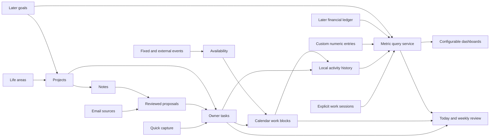
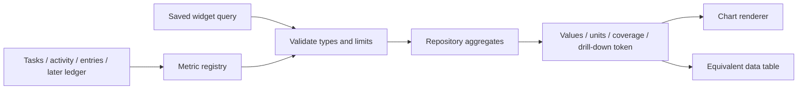

# Forewit future implementations

Research and repository review: 2026-10-11. Reviewed checkout: `afdbff6`.
Status: proposed product and implementation plan; no application features implemented
by this document. AGENTS.md and accepted ADRs still govern current behavior.

## 1. Product direction and decisions

Build a general personal life planner around one connected workflow:
**capture a commitment, organize it, plan time for it, do the work, and review progress.**
Email remains a useful input rather than the organizing principle of every screen.
Student features are shelved. Custom progress charts and a configurable dashboard
are part of the general-planner proof of concept (POC), not postponed until a
student edition or server build.

The complete feature list is in [Future feature inventory](future-feature-inventory.md).
Its stable IDs are used throughout this plan. Keep that inventory as the backlog;
use this document for implementation order, integration and acceptance criteria.

Recommended decisions:

1. Extend existing owner-owned actions into general tasks; keep one canonical task table.
2. Keep the Python/PySide6 desktop, service boundaries and SQLite for the POC.
3. Add activity history before task features start producing new progress data.
4. Keep deadlines, planned dates, calendar blocks and actual work separate.
5. Make dashboard queries typed, explainable and independent of chart rendering.
6. Reuse the current sidebar, visual tokens and detail components, with page-specific
   layouts for Today, Calendar and Insights.
7. Keep AI optional and proposal-based. Calculations and constraint checks run in code.
8. Complete desktop validation before implementing independent web/server operation.
9. Keep finance, full habits, extensive automation, collaboration and student tools
   in later/deferred phases. Simple custom numeric logs belong in the POC.

### What “industry standard” means here

There is no single industry standard for a personal planner. This research separates
documented product patterns (Todoist, Notion, Sunsama, Datadog, Actual Budget and
Loop), formal specifications (iCalendar and W3C accessibility guidance), and
Forewit-specific engineering recommendations. Recommendations are inferences
from those sources and the inspected code, not claims that every product uses the
same architecture. Vendor examples are precedents, not endorsements or required
integrations. Sources were accessed on the date above; recheck changing APIs,
packages and licensing before an implementation milestone.

## 2. Current Forewit: architecture and frontend audit

### 2.1 Verified foundations and gaps

| Area | Observed in the reviewed checkout | Implication for the planner |
| --- | --- | --- |
| Runtime | Python 3.13, PySide6 6.11.x, qasync, httpx, Pydantic, SQLAlchemy/aiosqlite and Alembic | Evolve the existing desktop; a browser rewrite is unnecessary for the POC. |
| Architecture | Domain models, ports, provider adapters, services, repositories and UI composition are already separated | New features should follow these boundaries instead of putting business rules in widgets. |
| Tasks | `Action` has public UUID, ownership, open/completed status, steps, notes, deadlines, target date, timestamps, revision and optional sources | Reuse this model/table. Add a manual creation path and general-planner fields. |
| Waiting | Waiting is `ownership=waiting_for` on an open action, not a third status | Preserve this distinction; use a Waiting filter in Tasks rather than adding a contradictory status. |
| Creation/editing | `ActionService.accept()` creates from suggestions; `ActionEdit` edits title, ownership, effort, target date and notes | Manual creation and explicit owner deadline editing need new validated contracts. A UI label change alone is insufficient. |
| Effort | Existing effort is coarse: minutes/hours/days | Add optional numeric estimated minutes for scheduling; never silently convert coarse effort into a precise duration. |
| Completion history | `complete()` sets `completed_at_utc`; `reopen()` clears it | Present state cannot reconstruct all historical completions or rescheduling. Add activity history transactionally. |
| Lists | Completed lists default to the newest 200; list loading also hydrates sources, steps and thread activity | Dashboard totals must use dedicated uncapped aggregate queries, not count UI rows. |
| Ownership/durability | Actions and drafts have no account foreign key; source snapshots survive cache/account deletion; soft deletion and revisions exist | Keep personal records independent of email accounts. Retain source provenance without copying incoming bodies. |
| Notes | Notes are `DraftKind.NOTE` in the existing draft model, with autosave and bounded versions | Reuse writing storage/editor initially; add project/note relationships instead of a competing note body store. |
| Calendar | `services/calendar.py` calculates local-day boundaries and resolves time zones | It is not an event store, calendar provider or scheduler. All three are new work. |
| Local data | SQLite connections use foreign keys, WAL and busy timeout; aware UTC timestamps are restored by a custom type | Suitable POC foundation; preserve transaction and timezone semantics. |
| Recovery | Snapshot validation rejects unexpected tables, all views and triggers | FTS5/shadow tables or trigger-maintained indexes cannot be added casually; recovery validation must be designed alongside them. |
| Portable export | `services/data.py` has an explicit `EXPORT_TABLES` list and format version | New planner records will not automatically appear in writing exports; extend/version exports and retention. |
| UI operations | `MainWindow.start()` serializes the current operation workflow; backend composition opens/closes operation resources | Add page controllers incrementally; define separate cancellable read refreshes later without breaking provider/recovery exclusivity. |
| Background operation | Automatic email refresh runs while the desktop is open | Do not promise closed-app reminders or server jobs in the desktop POC. |
| Acceptance | AGENTS.md records M4–M9 as implemented with owner/platform/live acceptance still outstanding | Existing code is a foundation, not proof that those milestones are fully accepted. Preserve the current validation gates. |

Evidence: [dependencies](../pyproject.toml), [actions domain](../src/mailbrief/domain/actions.py),
[action service](../src/mailbrief/services/actions.py), [action repository](../src/mailbrief/storage/actions.py),
[tables](../src/mailbrief/storage/tables.py), [date utilities](../src/mailbrief/services/calendar.py),
[database](../src/mailbrief/storage/database.py), [data/export service](../src/mailbrief/services/data.py),
[recovery validation](../src/mailbrief/storage/recovery.py), [desktop backend](../src/mailbrief/ui/runtime.py),
[main window](../src/mailbrief/ui/main_window.py), [agent guide](../AGENTS.md),
[action ADR](adr/0011-actions-and-suggestions.md) and [writing ADR](adr/0012-drafts-and-notes.md).

### 2.2 Visual inspection

Reviewed both the repository's [current workspace screenshot](ui/workspace-dark.png)
and [approved mockup](ui/mockup-three-pane-dark.png), then checked the implementation
in [workspace.py](../src/mailbrief/ui/workspace.py),
[actions_view.py](../src/mailbrief/ui/actions_view.py), the main window,
[UI specification](../.claude/skills/mailbrief-ui/references/spec.md) and
[design tokens](../src/mailbrief/ui/theme/tokens.py).

The screenshot shows a dark, restrained workspace: fixed navigation at left,
mail rows in the middle, selected content on the right, status/undo along the
bottom, and email sync in the header. Navigation currently contains Today,
Actions, Waiting, Drafts and Briefs, plus Saved mail, Data and Settings.
The code uses a 128-logical-pixel sidebar, stacked pages, a non-collapsible
list/detail splitter for the current Today page, bundled Inter, Tabler icons,
cosmetic hairlines, accessible names and keyboard shortcuts.

This works well for reading mail and task details. A seven-day calendar and several
charts need the whole content width. The existing `QStackedWidget` already allows
other page layouts, so keep the outer workspace and make the right detail pane
optional on pages that need room. The current Today page is a mail brief; move that
experience into Mail before replacing Today with the general planner home.

This was a source and repository-image review, not a fresh launch of a connected
app. The screenshots use example content. No real mailbox, live account, local
owner database or credential vault was inspected. At the initial research review,
the checkout had no project `.venv`; current UI tests were not run as part of this
documentation task. A locked environment was subsequently prepared for pre-push
lint and platform type checks, which do not replace live UI acceptance.

## 3. Research coverage and implementation recommendations

Every inventory feature is covered below by a cluster. Closely related features
share research because their correct behavior depends on the same model. Later and
deferred items are researched enough to establish integration and decisions; their
provider choices and detailed delivery designs should be revisited when activated.

### 3.1 Daily workspace, capture and reviews — A01–A08

**Observed pattern.** Sunsama documents guided daily planning, reviewing unfinished
work, duration estimates, workload warnings and optional timeboxing. Weekly planning
links objectives and reflections. These are useful precedents for a daily planner,
not evidence that users should be forced through a ritual.
[Sunsama daily planning](https://help.sunsama.com/docs/usage-guides/daily-planning/),
[weekly planning](https://help.sunsama.com/docs/usage-guides/weekly-objectives/weekly-planning/).

**Recommend.** Build Today as a read model combining selected tasks, events and
saved email information. Store a `DayPlan` with an ordered task selection and chosen
priorities; do not copy tasks into a second Today table. Capture saves immediately
with optional organization; project, date and estimate stay optional. Morning and
weekly reviews show deterministic records first; optional AI prose cites that
selection. End-of-day carryover is an explicit choice, not automatic deadline edits.
Search owner task/note text and permitted cached metadata/derived briefs. Do not
expand it into a full downloaded-email-body archive.

**Search implementation.** Start with bounded, parameterized queries and indexed
structured filters. SQLite FTS5 supports a richer search index, but in this repo it
requires an ADR, packaged-build capability checks and a recovery-compatible index
design. Prefer a rebuildable separate search cache if embedded FTS would complicate
trusted snapshot validation. Excluded/deleted content must leave the index.
[SQLite FTS5](https://sqlite.org/fts5.html).

**Fit/acceptance.** Today must work without Gmail or AI configured. Capture survives
restart, finding a result opens the canonical detail, and a missed review loses no
task. Reviews are derived views plus optional owner reflection notes.

### 3.2 Tasks, projects, life areas and commitments — B01–B12

**Observed pattern.** Todoist distinguishes a planned task date from a deadline and
documents scheduled-date versus completion-based recurrence. Notion supports views,
filters and grouping over the same records and relations between records.
[Todoist deadlines](https://www.todoist.com/help/todoist/features/introduction-to-deadlines-in-todoist-uMqbSLM6U),
[recurring dates](https://www.todoist.com/help/todoist/features/introduction-to-recurring-dates-YUYVJJAV),
[Notion database views](https://www.notion.com/help/views-filters-and-sorts),
[relations and rollups](https://www.notion.com/help/relations-and-rollups).

**Recommend.** Extend `actions`, with optional project, priority, estimate and
explicit origin (`manual`, `email`, later `note`/`import`). A project may have an
optional life area; tasks may remain unassigned. Tags are many-to-many. Keep coarse
AI effort alongside user-entered duration. Current checklist steps are sufficient
for POC substeps; true child tasks arrive when independent dates/scheduling are
needed. Dependencies are directed edges checked for cycles; completing a parent
must have an explicit policy rather than silently completing children. Board/list
views share the same query specification. Milestones are separately identifiable
project targets, not fake tasks needed to manipulate progress percentages.

For recurrence, store a series definition and durable occurrences, each with stable
identity and completion/skip history. POC supports daily, selected weekdays, weekly
and monthly-by-date schedules, with an explicit end-of-month policy. Do not implement
all iCalendar rule syntax or natural-language parsing at once. Completion-based
recurrence can follow and is distinct from calendar recurrence. Editing one occurrence
does not alter its series. Templates copy content into new IDs and preserve no
accidental links to the template's live tasks. Life-administration templates then
reuse this machinery.

**Fit/acceptance.** Manual tasks have zero sources and need no account. Waiting
uses existing ownership and optionally a follow-up date/person link. Promises from
mail are suggestions until accepted. Archiving a project keeps its history and
tasks; deleting an area does not delete its projects. Recurrence tests include
January 31, missed days, skipped occurrences and edits to future occurrences.

### 3.3 Calendar, availability and actual time — C01–C10

**Observed standard/pattern.** iCalendar defines date/time types, recurrence and
exceptions. Google Calendar distinguishes event series/instances and date-only
events; its event end is exclusive. Incremental synchronization uses provider tokens,
with invalid tokens requiring a fresh provider-cache sync.
[RFC 5545](https://www.rfc-editor.org/info/rfc5545/),
[Google recurring events](https://developers.google.com/workspace/calendar/api/guides/recurringevents),
[event resource](https://developers.google.com/workspace/calendar/api/v3/reference/events),
[incremental sync](https://developers.google.com/workspace/calendar/api/guides/sync).

**Recommend.** Separate local fixed events, flexible task work blocks and external
event caches. One task can have several work blocks; one event can have no task.
Store exact instants in UTC with IANA timezone, and keep all-day local dates as dates.
Availability is the union of configured windows minus the union of busy intervals,
buffers and downtime; overlapping meetings must not subtract the same time twice.
Show availability as incomplete until external commitments are entered or synced.
Locked events never move in a proposal. An owner may manually override a warning,
but no schedule proposal may claim feasibility when it violates a hard constraint.

Start scheduling with a bounded deterministic algorithm: order selected tasks by
explicit priority/deadline, fit known durations into available slots, and report
unplaced tasks. Use optional splitting only when a task permits it. AI may suggest
steps or explain a plan; code verifies the final proposal. OR-Tools demonstrates
constraint scheduling but adds substantial machinery; consider it only if actual
dependency/optimization needs outgrow the first scheduler.
[OR-Tools scheduling example](https://developers.google.com/optimization/scheduling/job_shop).

Read-only external calendars come later, behind a separate provider port and
Calendar OAuth permission. A `410` recovery clears only the affected external cache,
never local tasks or blocks. External edits, invitations and notifications require
separate ownership and permissions. Actual work comes from explicit work-session
records, with pause/correction and crash recovery; it is never inferred from blocks.
Meeting prep links records rather than copying an entire project into AI context.
Reminders use opt-in policies, quiet hours and one occurrence/delivery key. Qt tray
notification support is platform-dependent; test delivery rather than promising
closed-app alerts.
[Calendar scopes](https://developers.google.com/workspace/calendar/api/auth),
[Qt tray notifications](https://doc.qt.io/qt-6/qsystemtrayicon.html).

### 3.4 Email and communication — D01–D09

**Observed constraint.** Gmail read-only access allows reading; draft management
and sending use different scopes. Forewit currently has only read-only Gmail.
[Gmail scope definitions](https://developers.google.com/workspace/gmail/api/auth/scopes).

**Recommend.** Preserve existing briefs, consent, sender exclusions, selected body
downloads, bounded evidence, follow-up proposals and local drafting. Start project
mail links as owner-selected relationships. A broader thread summary requires
bounded context and its own preview, not merely a longer call on every cached email.
Define unanswered tracking narrowly: a tracked request, the expected responder,
an owner-selected follow-up date and observable thread activity. Presence of a new
reply does not establish that a request was answered or a task completed.

Multiple accounts need distinct credentials, sources and consent; automatic job
ownership must prevent duplicate analysis/charges. Keep Outlook dormant until its
milestone is activated. What-changed views derive from last-seen watermarks and
confirmed activity. Gmail draft saving/sending is deferred and requires an ADR
that explicitly changes the current invariant; a local draft's copy/export event
is not evidence of a sent message. The POC does not request write scopes.

**P0 extension (D09).** Manual approval of 20 overnight emails is not a workable
privacy model. The P0 goal is to summarize eligible email *locally* without
per-message cloud approval, and to make optional cloud enhancement a separately
consented operation. A classifier may block or flag content but must not be
treated as proof that it is safe to disclose. See [P0-B](#71-p0-b-local-first-email-privacy-and-responsiveness-d09).

**Fit/acceptance.** An accepted email task behaves exactly like a manual task while
retaining its source snapshot. Clearing mail never deletes owner tasks/notes;
regenerating a brief never silently edits them.

### 3.5 Notes, knowledge, attachments and templates — E01–E06

**Observed pattern.** Obsidian exposes links back to the current note and reusable
text templates. Notion relations demonstrate connected records without needing
duplicated content.
[Obsidian backlinks](https://obsidian.md/help/plugins/backlinks),
[templates](https://obsidian.md/help/plugins/templates).

**Recommend.** Keep `DraftKind.NOTE` and existing revisions for POC owner writing;
add typed task/project relationships, an indexed title/body search and modest editor
formatting. Do not mix plain Markdown and rich HTML under one ambiguous format.
Backlinks are inverse relationship queries, not new copied notes. Project context
pages query those links along with tasks and mail-source snapshots. Meeting notes
are templates with event/project links, decisions and proposed tasks. AI extraction
never creates confirmed tasks without owner review.

Later file support needs explicit imported-asset records: safe local identifier,
MIME/type, size, digest, storage location and owner-controlled retention/export.
Validate paths and opening behavior; bookmarks are links, not automatic page crawls.
Backups must include owned assets or visibly explain omissions. Email attachments
and incoming body retention are new capabilities requiring privacy/ADR changes;
existing email consent does not cover them.

### 3.6 Goals, habits and custom measurements — F01–F06

**Observed pattern.** Loop documents flexible schedules, reminders, graphs and
CSV/SQLite export. Metrics systems distinguish accumulations from current-value
measurements; that distinction is useful even without adopting a telemetry stack.
[Loop Habit Tracker](https://github.com/iSoron/uhabits),
[OpenTelemetry metric concepts](https://opentelemetry.io/docs/concepts/signals/metrics/).

**Recommend.** POC custom metrics have a name, unit, measurement kind, permitted
aggregation and dated entries. Reading minutes are amounts to sum; a savings
balance is a point-in-time value to display as latest, not a value to sum. Support
editing/deleting entries with revision checks and owner-visible corrections. Goals
later reference a metric/target or project milestone rather than duplicating their
records. A routine is repeated work; a habit adds an expectation and observation
policy. A three-times-per-week habit is not equivalent to three rigid weekly tasks.
Define skipped, missing and completed separately before heatmaps or completion
percentages. Mood/energy check-ins are optional sensitive owner entries; never
infer them from email or use them as a medical assessment.

**Fit/acceptance.** Custom logs and task-derived measures share the dashboard query
interface but remain different sources. Editing an entry updates every relevant
widget. Goal plans and habit reminders remain proposals/opt-in settings. No global
productivity score is required.

### 3.7 Custom dashboards and charts — G01–G11

**Observed pattern.** Datadog builds dashboards from configurable widgets with data
sources, units and timeframes; template variables scope related widgets. Its query
value widget supports explicit reduction and comparison; context links connect
charts with details. Notion demonstrates charts over existing records.
[Datadog widgets](https://docs.datadoghq.com/dashboards/widgets/),
[template variables](https://docs.datadoghq.com/dashboards/template_variables/),
[query value](https://docs.datadoghq.com/dashboards/widgets/query_value/),
[context links](https://docs.datadoghq.com/dashboards/guide/context-links/),
[Notion charts](https://www.notion.com/help/charts).

**Recommend.** Adopt the composable widget idea with personal-planning language:
choose a metric, filters, grouping, range and chart, preview it, then save. POC has
one saved dashboard, number cards, line charts, bars, a starter layout and keyboard
reorder/size controls. Dragging/resizing may supplement those controls. Store the
layout and typed query configuration, not copied chart values. Add targets and a
data table/drill-down from the beginning. Later add dashboards, heatmaps, progress
bars, composition charts, templates, exports, formulas and alerts.

Use bars for categories and discrete daily counts, lines for appropriately ordered
measurements, and number cards for scalar summaries. Do not default to pie/donut
charts for detailed category comparisons. Full metric semantics, query design,
rendering options and correction behavior are specified in section 5.

### 3.8 Money and spending — H01–H07

**Observed pattern.** Actual Budget documents mapped file imports and reconciliation
and separates transaction schedules from posted records. Plaid returns additions,
modifications and removals; banking data is not an immutable receipt feed.
[Actual import](https://actualbudget.org/docs/transactions/importing/),
[schedules](https://actualbudget.org/docs/schedules/),
[Plaid Transactions](https://plaid.com/docs/transactions/).

**Recommend.** Begin later with a dedicated transaction model, manual entry and
previewed CSV import. Store an exact decimal representation or integer minor units
with currency exponent/code; never binary floating-point money. Define expense,
income, transfer, refund and reimbursement treatment before totals. A bill is a
forecast obligation, not proof of payment; completing a payment task does not
create a posted bank transaction. Link tasks and sources to bills/transactions.
Use provider/source identity for reliable deduplication, with date/amount/merchant
similarity only to propose a match.

Receipt extraction creates a proposal showing amount, currency, date, merchant and
evidence locations. Document-processing APIs expose confidence and anchors; use
those as review aids, not proof the amount is correct.
[Document AI response structure](https://docs.cloud.google.com/document-ai/docs/handle-response).
The POC savings log remains a generic user measurement. Later finance dashboards
use the transaction source, exclude transfers where appropriate and never add
different currencies without an explicit conversion policy. Bank connections are
deferred: account coverage, provider secrets, server/webhooks and reconciliation
need a separate design; no banking provider is selected here.

### 3.9 People and relationships — I01–I03

**Observed pattern.** Google's People API uses contact-specific read/write and sync
behavior; this is a separate integration from Gmail reading.
[People API contacts](https://developers.google.com/people/v1/contacts).

**Recommend.** Start later with owner-curated local person records and links to
commitments, notes and meetings. An email address is a matching hint, not a globally
unique person identity. A person may have several addresses; merges are reviewed.
Importing contacts requires its own permission and adapter. Follow-up tasks should
reuse Waiting and recurrence; avoid a second relationship-reminder engine.

### 3.10 AI and automation — J01–J07

**Observed pattern/guidance.** Notion documents triggers and actions and explicit
limits on automation chaining. AWS's outbox pattern addresses atomic persistence
before asynchronous delivery. OWASP describes indirect prompt injection and calls
for execution-side permission checks beyond prompt wording.
[Notion automations](https://www.notion.com/help/database-automations),
[transactional outbox](https://docs.aws.amazon.com/prescriptive-guidance/latest/cloud-design-patterns/transactional-outbox.html),
[OWASP prompt injection guidance](https://cheatsheetseries.owasp.org/cheatsheets/LLM_Prompt_Injection_Prevention_Cheat_Sheet.html).

**Recommend.** POC reuses email/drafting capabilities and adds a small selected-task
breakdown proposal. A deterministic plan/weekly review works without AI. Later
retrieval searches only selected/permitted records and returns internal citations;
start with lexical retrieval before considering embeddings. Context preview states
which fields leave the device. Cross-workspace questions, meeting briefs and
project updates cannot inherit permission from a single-email analysis.

Later rules have typed trigger, condition and action definitions, preview, run
history and bounded undo. Begin with creating a proposal or local reminder, not
external sending. Persist a job/outbox entry in the same transaction as its trigger;
use unique execution keys, retry limits and chain-depth protection. Consent and
permission are rechecked at execution. Separate read permission, proposal
generation and permission to apply changes. Test hostile source text with dummy
adapters; no model gets database-write authority or raw SQL/Python execution.

### 3.11 Customization, accessibility, offline access and sync — K01–K07

**Observed pattern/guidance.** Notion offers typed properties and saved views.
Ink & Switch's local-first work emphasizes offline ownership and preservation.
W3C guidance requires alternatives to dragging and explanations for complex
graphics; here it is used as a design benchmark for native desktop controls,
not a claim of certified WCAG conformance.
[Notion properties](https://www.notion.com/help/database-properties),
[local-first research](https://www.inkandswitch.com/local-first-software/),
[drag alternatives](https://www.w3.org/WAI/WCAG22/Understanding/dragging-movements.html),
[chart descriptions](https://www.w3.org/WAI/tutorials/images/complex/).

**Recommend.** Keep optional depth: simple task capture must work without projects,
estimates or dashboards configured. Typed custom fields and saved queries come
later, with limited supported types and validated migrations. Add a searchable
command palette and keyboard capture early. Chart widgets expose titles, units,
ranges, textual summaries and an equivalent data table. Calendar block moves and
dashboard ordering have keyboard and single-click alternatives.

Extend backup, exports, restore and retention for every new persistent entity.
Local storage is not encrypted by the existing app; adding health/finance data
requires an explicit data-custody decision, not claims that local implies encrypted.
Web/mobile/device sync stays deferred. Preserve UUIDs, revisions and portable
relations now; choose server-authoritative or bidirectional sync after desktop use.
Revisions alone are not a complete multi-device protocol. No HTTP service, hosted
jobs or cloud storage is needed to ship the POC.

### 3.12 Collaboration — L01–L02

**Observed pattern.** Notion exposes multiple sharing/access levels and inheritance
behavior, illustrating that collaboration requires more than an assignee field.
[Notion permissions](https://www.notion.com/help/sharing-and-permissions).

**Recommend.** Defer until identity, workspace ownership, record-level access,
revocation, synchronization and deletion semantics exist. Shares must not expose
private mail-source snapshots or personal dashboard records automatically. Comments
and shared activity need server-side authorization, and charts/search/AI must use
the same access rules as record reads. Contacts and Waiting do not imply sharing.

### 3.13 Student expansion — S01–S08, shelved

Research is retained to avoid designing foundations that block a future extension.
No student UI or data tables are part of the POC.

| Feature IDs | Later integration and research basis |
| --- | --- |
| S01, S02 | Course/term metadata over projects and assignment templates over tasks; reuse date, recurrence and linked-note decisions. |
| S03 | Syllabus parsing uses reviewed extraction with original document anchors and proposed dates/weights; Document AI illustrates structured outputs. A course schedule remains owner-confirmed. |
| S04 | Exam milestones and study work blocks use the same constraint scheduler and availability model. |
| S05 | Separate deterministic grading model: points within groups, group weights, missing/excused grades, drop rules and extra credit. Canvas documents weighted group calculations and scenario grades. |
| S06 | Note summaries/practice questions reuse selected-context AI; flashcards need a separate review-history/scheduling model. Anki documents FSRS rather than treating review as a fixed recurring task. |
| S07 | Local responsibility/waiting tracking works first; shared group assignments depend on the collaboration milestone. |
| S08 | Student budget categories/templates reuse the general financial ledger. |

Sources: [Canvas weighted groups](https://community.instructure.com/en/kb/articles/660669-unknown),
[Canvas what-if grades](https://community.instructure.com/en/kb/articles/662757-what-are-what-if-grades),
[Anki deck options](https://docs.ankiweb.net/deck-options.html).

## 4. How the features connect

### 4.1 Shared records, separate responsibilities



The diagram shows read/link dependencies, not automatic authority to change a
record. A proposal becomes a task only when accepted. A dashboard reads records;
it does not own their state. Explicit user commands go through services.

| Entity | Relationship and lifecycle rule |
| --- | --- |
| Task/action | One owner-owned record; zero or more sources, steps and work blocks. No required mailbox/account link. |
| Project/area | Optional organization. Archive preserves links and history; removing organization does not delete work. |
| Source reference | Provenance snapshot plus optional live cache link. Mail cache deletion keeps owned records; no incoming body copies. |
| Note/draft | Owner writing and bounded versions, with typed links. A generated version does not complete its linked task. |
| Day plan | Owner selection/order for a local date and zone; references tasks and may retain an estimate snapshot for review. |
| Calendar event | A real appointment/busy interval or all-day item. External cache ownership remains distinct from local ownership. |
| Work block | Planned interval linked to a task; multiple blocks allowed. Unscheduling keeps the task. Task completion does not erase historical blocks. |
| Work session | Explicit recorded time, separate from the plan, with pauses and corrections. |
| Recurrence series/occurrence | A reusable schedule and uniquely identified instances; repeating must not overwrite completion history. |
| Activity record | Minimal semantic transition, IDs, revisions and relevant grouping at the time; committed with the change. Not a raw content log. |
| Metric definition/entry | Typed custom measurement schema plus owner-entered observations; task-derived metrics query their own source. |
| Dashboard/widget | Saved presentation and query definitions. Deleting a dashboard leaves underlying records intact. |
| Goal/habit/bill | Later entities reference existing work/measurement data; bills and habit expectations do not invent observations. |

### 4.2 End-to-end examples

**Personal appointment.** Capture “Book dentist” as a manual task in Health. Choose
a target day, schedule a 15-minute call block, and complete the task after booking.
Create a separate fixed appointment for the visit. A completion chart gets one
completion; the calendar contains a planned call and actual appointment, not an
assumed 15 minutes of measured work.

**Email commitment.** Mail proposes “Send renewal documents by Friday.” Accept into
a Home project, add checklist steps and two work blocks, and link an owner note.
A later reply proposes a deadline change. Preview/apply it, then separately review
rescheduling. Source deadline changes do not silently move locked appointments.

**Custom progress.** Define Reading minutes as a summed amount, record dated
entries, add a weekly bar widget and target, and drill into the entries. Define
Savings balance as a point-in-time value and view its latest value/line instead.
The second metric cannot be totaled as spending or inferred bank transactions.

**Later finance.** A receipt proposes an expense; confirmation creates a transaction
and optional return/reimbursement task. Imported bank data may later match the
transaction. The task, bill forecast, receipt proposal and posted transaction are
linked records; only the configured ledger records contribute to spending totals.

### 4.3 Application structure and migrations

Keep the existing ports/adapters design. Suggested modules are new work, not
present files:

| Layer | Proposed responsibilities |
| --- | --- |
| `domain/` | Extend actions; add projects, planning, events/blocks, recurrence, activity, metrics and dashboard contracts. |
| `services/` | Manual task creation, project organization, day plans, availability/schedule checks, metrics queries, dashboard management and reviews. |
| `storage/` | Normalized tables/repositories, transactional activity writes, bounded aggregate queries, portable exports and retention. |
| `ports/` and `providers/` | Later calendar, extraction and financial adapters; keep provider JSON inside adapters. |
| `ui/` | Thin page controllers and views for Today, Tasks, Calendar, Notes and Insights, using common detail components and tokens. |
| composition | Keep runtime wiring explicit; smaller capability protocols can be introduced as new pages arrive instead of expanding one enormous backend protocol indefinitely. |

First add organization fields/tables and a manual `ActionCreate` contract; retain
existing names internally to avoid a disruptive table/API rename. New entities get
public UUIDs, revision checks, aware UTC metadata and explicit deletion/retention.
Current deadline evidence remains provenance; if the owner can override a deadline,
record the origin/override explicitly and preserve the original source statement.

Each milestone gets a new additive Alembic revision, migration/backfill tests,
updated portable export format, recovery schema validation and package checks.
Do not edit historical revisions. Start indexes with task status/project/date,
activity type/time/task, block start/end, and metric entry definition/date. Measure
queries before adding rollup tables or caches.

Write the record change and activity within one service transaction. Keep existing
expected-revision conflict handling and ORM mutations; SQLAlchemy documents why
bulk update/delete bypasses its row version checks. Future stronger concurrent
write support needs conditional revision checks at the database boundary, not only
a comparison in a stale UI.
[SQLAlchemy version counters](https://docs.sqlalchemy.org/en/20/orm/versioning.html).

The history is a small local analytic journal, not an event-sourced rewrite. Keep
normal tables authoritative. Imported legacy task timestamps support only an
explicitly labelled baseline; no fabricated reschedules, reopened episodes or
past project membership. Define how corrections, undo, restore and intentional
history retention affect statistics before exposing trends.

## 5. Dashboard and metric implementation in detail

### 5.1 Separate metric meaning, query and presentation



The registry defines permitted aggregations and filters per metric. A chart renderer
only receives prepared values and labels. It never queries SQLite or interprets
owner formulas. Shared logic later supports a web frontend without reusing Qt widgets.

Datadog's JSON configuration is a precedent for saved widget definitions, not a
reason to expose infrastructure query syntax to planner users.
[Datadog graph configuration](https://docs.datadoghq.com/dashboards/guide/graphing_json/).

Proposed typed records:

| Record | Minimum fields |
| --- | --- |
| Built-in metric descriptor | Stable key, definition version, label, source, unit, metric kind, allowed aggregates, dimensions, correction policy and history coverage. |
| Custom metric definition | UUID, name, unit, scale, amount/point-value kind, allowed aggregate, optional target and revision. |
| Custom entry | UUID, definition ID/version, exact scaled integer value, recorded local date or aware timestamp, zone, optional project, creation/update metadata and revision. |
| Dashboard | UUID, title, versioned layout, global range/zone/filter settings and revision. |
| Widget | UUID, dashboard ID, metric key, validated query, visualization settings, position/size/order and revision. |
| Query result | Buckets/values, unit, effective filters/range/zone, data freshness, coverage gaps, definition version and drill-down specification. |

Use fixed-scale integer values with bounded input precision for POC numeric logs;
display/averages use exact decimal arithmetic before chart conversion. A definition
change must not reinterpret old values. A savings balance uses an explicit currency
unit but is still an observation, not an accounting ledger. Later currencies use
their own exponent rules and separate totals.

### 5.2 First metrics and their exact meanings

| Metric | Calculation | Important interpretation |
| --- | --- | --- |
| Tasks created | Count task creation records in a half-open time range | Creation origin is manual/email/etc.; accepted suggestions count only when an owned task is created. |
| Task completions | Count effective completion episodes in range, deduplicated by event ID | Ordinary reopening keeps the past episode; a later completion is another episode. Label it “completions,” not “unique tasks.” |
| Distinct tasks completed | Distinct occurrence/task IDs with effective completions in range | Optional alternate measure. Unique counts are not additive across daily buckets; explain that difference in cards/totals. |
| Currently overdue | Count live open tasks whose resolved deadline has passed as of now | This is current state. Do not show a historical overdue line until state history/snapshots support it. Target-date carryover is a different concept. |
| Completions by project | Group completion episodes by project at the time of completion | Later task reassignment does not rewrite past charts. Include Unassigned and archived/deleted group labels. |
| Selected workload | Sum known estimates for distinct selected tasks/occurrences in a day plan | Show missing-estimate count and avoid claiming those items consume zero time. |
| Scheduled task time | Duration of work blocks, clipped to the selected range | Label scheduled, not actual. Overlap is flagged; total scheduled duration and unique occupied time are distinct measures. |
| Available time | Duration of availability windows minus unioned busy intervals and buffers | Incomplete calendars make capacity provisional. |
| Custom amount | Sum valid entries in the range, e.g. reading minutes | Missing logging is unknown unless the owner explicitly recorded zero. |
| Custom point value | Last observation at/before the range end, e.g. savings balance | Include observation date and staleness; never sum balances. |
| Actual work, later | Sum explicit session segments after pauses/corrections | Timers must recover unfinished sessions after a crash; a calendar block alone contributes nothing. |
| Spending, later | Sum the ledger's eligible transactions by currency/category | Posted/pending policy, refunds and excluded transfers must be visible. |

“Effective” means not invalidated by an explicit correction/undo. Reopening is a
real transition, whereas undoing an accidental completion corrects that episode.
Record those as distinct operations. A later re-completion is not an accidental
duplicate, but a retried write with the same command ID is. A dashboard must explain
which policy it uses. Do not use completed-list length or cached shortlist counts
as a substitute for these queries.

### 5.3 Time, gaps, targets and grouping

- Resolve calendar buckets in the selected IANA zone using local-day boundaries.
  Use `[start, end)` UTC intervals so midnight is counted once. A local day may have
  23 or 25 hours. Do not bucket UTC timestamps by a naive UTC `date()` for local charts.
- Capture event grouping IDs at the time of the transition. Current task filters and
  historical grouping must be named distinctly if both are later offered.
- Persist metric entry local dates when the owner means “on this day,” rather than
  turning every log into midnight UTC. Travel does not shift a date-only diary entry.
- Zero is valid for complete event-count coverage; a logging gap is missing, and an
  integration failure is unavailable/stale. Draw gaps explicitly. No automatic
  interpolation for personal logs or bank balances.
- A latest-value card may use an observation before the visible range; label its
  date and carry-forward policy. A line should not imply a measured value on every day.
- POC supports simple numeric targets in the metric's unit. Comparisons use matching
  previous ranges; do not compare a partial week with a complete week without a label.
  A zero prior value gives an undefined percentage change, not infinity.
- Limit POC time ranges/group counts/points and coarsen buckets visibly when needed.
  Proposed initial caps are 12 widgets, 366 daily buckets and 20 named categories,
  with an Other group whose membership remains inspectable. These are starting
  product limits to benchmark, not measured performance claims.
- Generic formulas later use a typed expression tree, allowlisted functions,
  compatible units, bounded nesting and cycle detection. Division by zero produces
  unavailable with a reason. Never store runnable Python or unvalidated SQL.

### 5.4 Activity history and corrections

Add a minimal activity table with event UUID, task/entity UUID, command UUID,
event kind, aware occurrence/recording time, resulting revision, grouping IDs at
the time, and optional `corrects_event_id`. Keep payloads bounded and avoid task
notes, mail bodies, addresses and draft text. Record creation, completion, reopen,
date changes, block changes and explicit corrections; do not log every mouse move.

The service transaction either commits state plus its activity or neither. A unique
command/event constraint prevents retry duplicates. A completion followed by ordinary
reopen remains part of work history. Undo appends a correction targeting its event.
This preserves both truthful activity and corrected statistics. Soft deletion keeps
history until the owner explicitly purges it. A purge also removes/rebuilds relevant
indexes and exposes the retained coverage window; it must not claim lifetime totals
after history has been removed. Export includes definitions and correction relations.

At migration, existing current completion timestamps can seed labelled observed
baseline events if desired. They cannot recover all past completion episodes.
New rescheduling and estimate history begins at enablement. Show “Tracking since …”
where older history is unavailable.

### 5.5 Query and refresh behavior

Queries run asynchronously through repositories over normal tables and the history,
with parameterized filters. Generate timezone bucket boundaries in Python and query
those intervals; choose database aggregation or bounded postprocessing based on
benchmarks. Avoid arbitrary owner-supplied SQL. Index event timestamps/types and
entity/group IDs. Use dedicated aggregate endpoints and paginated drill-down.

For each refresh, read against a consistent transaction/snapshot or report the same
data revision. A chart click carries the exact metric definition, time range,
filters and correction policy, so its detail table reconciles to the total.
As data changes, show that the drill-down refreshed instead of silently mixing
different snapshots. Coalesce refreshes after confirmed edits and local-day changes;
do not poll every chart every second. Cancel/discard stale results after page/filter
changes. Add a cache only after performance measurements show a need.

Proposed initial benchmark fixture: 10,000 tasks, 100,000 activity records, 50,000
custom entries and 12 widgets. Aim for a usable first dashboard within one second
on a documented reference machine and no GUI blocking; these are targets, not
results from this research task. Increase scale before server work only if usage
justifies it.

### 5.6 Renderer options and recommendation

| Option | Fit and costs | Recommendation |
| --- | --- | --- |
| Small Qt Widgets/QPainter charts | Uses existing Qt and tokens; bounded line/bar drawings are feasible. Requires our own axis layout, hit testing, focus and accessible table. | POC candidate after a focused visual/interaction spike; keep scope to simple charts. |
| PyQtGraph | Qt plotting library with an MIT license; introduces plotting/NumPy dependencies and packaging/theme integration work. | Evaluate if interaction/axes make custom painting more costly. Requires a scoped dependency decision and Python 3.13/platform checks. |
| Qt Graphs 2D through QQuickWidget | Qt's 6.11 example embeds a Qt Quick graph in a Widgets app. QML resources, render-loop costs and module licensing need consideration. | Optional later candidate; not a drop-in QWidget chart replacement. |
| Qt Charts | Official docs mark it deprecated since Qt 6.10 | Avoid as the default for new work. |
| Embedded web chart runtime | Can provide rich charts but adds web rendering, bridge validation and packaging surface to this native app | No need to introduce it for three POC chart types. Reconsider with the actual web frontend. |

Sources: [QPainter](https://doc.qt.io/qtforpython-6/PySide6/QtGui/QPainter.html),
[PyQtGraph documentation](https://pyqtgraph.readthedocs.io/en/latest/),
[PyQtGraph license](https://github.com/pyqtgraph/pyqtgraph/blob/master/LICENSE.txt),
[Qt 6.11 Widgets graph example](https://doc.qt.io/qt-6.11/qtgraphs-2d-quickwidgetgraphs-example.html),
[QQuickWidget considerations](https://doc.qt.io/qt-6/qquickwidget.html),
[Qt Charts status](https://doc.qt.io/qt-6/qtcharts-index.html),
[Qt module licensing](https://doc.qt.io/QT-6/licensing.html).

The repository UI skill currently says to add no dependencies. This planning task
adds none. Prefer an existing-Qt spike; if it fails the defined visual/accessibility
gate, scope a dependency change explicitly in its implementation plan/ADR rather
than treating a research candidate as automatically approved. Qt Graphs is listed
as GPLv3/commercial; its availability inside a binding does not settle distribution
terms. This is a component-selection gate, not a legal conclusion.

The renderer spike must cover empty/missing/zero data, long labels, dense daily
series, dark tokens, target lines, keyboard selection, record drill-down, screen
reader table access and native packages at 100%/200% scale. If custom painting
cannot meet those needs at reasonable complexity, select the validated alternative
before building the full dashboard editor. Do not solve accessibility by tooltip alone.

## 6. Frontend integration plan

### 6.1 Navigation and migration of current screens

Proposed POC sidebar: **Today, Tasks, Projects, Calendar, Notes, Insights, Mail**.
Keep Data and Settings in the footer. Show only implemented pages. Capture is a
header action/shortcut with an inbox filter, not a compulsory eighth top-level page.
Waiting becomes a prominent saved Tasks view; it should retain an accessible
shortcut during the transition.

| Current destination | Proposed location | Preserve |
| --- | --- | --- |
| Today mail brief | Mail → Current brief | Existing list/detail, summaries, source links, accept/dismiss and draft actions. |
| Actions | Tasks → Mine/open | Existing UUIDs, steps, notes, revision checks and actions. |
| Waiting | Tasks → Waiting | Ownership semantics, thread activity and follow-up proposals. |
| Drafts | Notes → Writing, or Mail → Drafts filter | Existing drafts/notes, versions, selected-context AI and export. Views share records. |
| Briefs | Mail → Brief history | Saved dates, coverage, catch-up bounds and partial/error states. |
| Saved mail | Mail → Saved metadata | Offline browsing without claiming saved bodies. |
| Sync and review | Mail toolbar plus optional global sync action | Two-step review/consent flow, cancellation and remembered declines. |
| Data / Settings | Footer destinations | Backup, restore, preferences, permission status and disconnect. |

Use an internal routing map so opening an older brief still shows its date/banner
on Mail, not the new planner Today. Update shortcuts, accessible names and tests
together. Keep public MainWindow attributes while extracting page controllers;
existing tests/modules reference them. No migration should discard saved selections
or owner content merely to rename navigation.

### 6.2 Page layouts

| Page | Layout and behavior |
| --- | --- |
| Today | Date and capture at top; chosen priorities and agenda; important mail summary; compact progress cards. Clicking any item opens its canonical detail. Most content is read-only projection; ordering is an owner day-plan edit. |
| Tasks | List beside detail, building on current Actions. Toolbar for capture, project/area/status filters and sorting. Optional later board view; Waiting and Completed remain easy to find. |
| Projects | Project list beside context detail. Start with task list and linked notes; add milestones, mail, files, expenses and metrics when those sources exist. |
| Calendar | Content-wide week/day view with date toolbar and an unscheduled-task panel. Selected event/block opens a temporary inspector; collapse it to recover width. Narrow windows switch to agenda with scheduling forms. |
| Notes | Searchable list beside editor/detail, with Notes/Writing filters and related-record links. Preserve autosave/conflict recovery rather than replacing the storage model. |
| Insights | Content-wide widget grid, dashboard/range/filter toolbar and Add widget/Edit controls. A configuration inspector appears only while editing; reading charts uses the available width. |
| Mail | Existing brief experience plus local tabs/filters for briefs, saved metadata and drafts. Sync progress/consent stays contextual to Mail. |

Conceptual page composition (not pixel-approved mockups):

```text
TODAY
+------------+------------------------------------------------------+
| Navigation | Sun Oct 11                 Search       + Capture    |
|            |------------------------------------------------------|
| Today      | Priorities / selected tasks | Today's agenda         |
| Tasks      | Book dentist       15 min   | 10:00 appointment       |
| Projects   | Renew document     30 min   | 14:00 flexible work     |
| Calendar   |------------------------------------------------------|
| Notes      | Important mail              | Upcoming commitments   |
| Insights   |------------------------------------------------------|
| Mail       | Completions this week | Reading minutes | View charts|
| Data       |                                                      |
| Settings   |                                                      |
+------------+------------------------------------------------------+
| Status: saved                                      Undo           |
+-------------------------------------------------------------------+

CALENDAR
+------------+------------------------------------------------------+
| Navigation | Previous   Oct 12-18   Next      Day / Week            |
|            |------------------------------------------------------|
| Calendar   | Unscheduled | Mon | Tue | Wed | Thu | Fri | Sat | Sun  |
|            | tasks       |      fixed events / flexible blocks      |
|            |             |      deadline markers                     |
|            |------------------------------------------------------|
|            | Selected block: task / duration / lock / move / remove|
+------------+------------------------------------------------------+

INSIGHTS
+------------+------------------------------------------------------+
| Navigation | My Week    Last 7 days   All areas    + Widget   Edit  |
|            |------------------------------------------------------|
| Insights   | Completions    | Currently overdue | Reading minutes  |
|            | 18 episodes    | 3 as of now       | 140 logged       |
|            |------------------------------------------------------|
|            | Daily completions chart | Reading trend chart        |
|            |------------------------------------------------------|
|            | By project bar chart    | Open contributing records  |
+------------+------------------------------------------------------+
```

All sample values are illustrative; they are not observations from the user's data.

### 6.3 Preserve the design system, expand layouts carefully

Keep bundled typography/icons, restrained accent/warning colors, row selection,
hairlines and visible undo. Add any chart-series colors to `theme/tokens.py`, with
labels/patterns as well as color. Task/metric titles and AI/mail text stay plain or
escaped through the existing safe helpers; no mail-derived HTML, tooltips or automatic
links. For chart inspection, use a focusable detail label/table rather than placing
owner/mail text into a tooltip. Future external links require their own validated
opening policy; current source buttons remain Gmail-only.

The current 128 px sidebar may not fit expanded labels/counts well. Prototype an
approximately 160–180 px token-backed width or a collapsible variant; validate total
content width at 1100 × 720 before adopting it. This is a design experiment, not a
fixed new dimension. Preserve a usable narrow layout rather than simply increasing
minimum window size. Calendar agenda and dashboard single-column mode should be
available without horizontal page scrolling.

Start dashboard layouts with deterministic row ordering and small/medium/wide
size presets, supported by explicit move controls. Add drag handles and resizing
only in edit mode so ordinary chart clicks still inspect data. Save changes with
revisions, offer undo, and restore the previous layout on cancellation. A later
general free-form grid is optional. A shared detail router can open a task, note,
event or metric entry without duplicating edit state across pages. Qt's model/view
pattern supports sharing data models across views; it does not remove the need
for service-level validation.
[Qt model/view programming](https://doc.qt.io/qt-6/model-view-programming.html).

Keep header capture/search general and label integration status specifically.
“Checked Gmail …” cannot serve as an all-workspace freshness indicator. Insights
shows local history coverage and custom-log observation dates; Calendar later
shows each external calendar's sync status. POC planner actions remain usable
offline while Gmail/AI operations report their own availability.

## 7. Delivery sequence and gates

These are dependency-ordered milestones, not calendar estimates. Keep POC naming
separate from existing M1–M9 so completed email history is not rewritten.

| Phase | Deliverable and covered scope | Depends on | Acceptance gate |
| --- | --- | --- | --- |
| P0-A: Existing foundation | Finish relevant owner/platform/live acceptance for current email and recovery behavior; document known limits | Existing M4–M9 | Real owner records survive restart/export/restore; outstanding platform checks remain visible. Planning future work does not mark these accepted. |
| **P0-B: Privacy-first email AI** | **D09: local-first summaries, selective cloud enrichment, caching and background precomputation** | Existing email contracts; local-model feasibility spike | **20 mixed overnight emails need no per-message approval for on-device summaries; no third-party requests in local-only mode; cached results render without waiting for pending analyses.** |
| P1: General task foundation | B01–B08 basics, project/area grouping, quick task capture, activity history, export/migration updates | P0-A validation findings; honor P0-B privacy contracts for email | A manual source-free task and accepted email task share edit/complete/reopen/undo paths; recurrence and history survive restart. |
| P2: Personal workspace | A01–A05, A08, E01–E02, keyboard capture/search and linked notes; current brief routed to Mail | P1 | Manage a day without Gmail/AI. Search opens canonical records; owner writing survives conflict/cache clearing. |
| P3: Local calendar | C01–C05, work blocks, availability settings and overload warnings | P1, P2 | Plan a week, move/resize/unschedule with keyboard and undo; respect fixed events, date semantics and missing estimates. |
| P4: Custom progress dashboards | F02, G01–G03, G05–G07, G09; one saved layout/template, targets and data inspection | P1 history, P2; P3 for workload widgets | Create custom entries, edit/reorder/resize widgets, restart and restore them; totals match drill-down and handle corrections/gaps. |
| P5: Review and optional assistance | A07, limited J01/J07; deterministic weekly review, optional selected-task AI breakdown; modest daily schedule proposal as stretch | P1–P4 | Two-week owner trial meets the POC success criteria; failure/decline of AI leaves confirmed plans unchanged. |
| P6: Deeper general planner | Later task views/templates/milestones/dependencies, full goals/habits, focus sessions, richer notes/contacts, manual finance/CSV and advanced dashboards | POC observations | Each module solves a demonstrated need and extends backup/history/query contracts coherently. |
| P7: Integrations and rules | Read-only calendars, extra email accounts/providers, reviewed receipt extraction, later rules/notifications and optional external writes | P6 or a scoped earlier integration need | Retry/dedup/conflict tests, explicit capability permission and reliable source ownership. No duplicate local/external records. |
| P8: Web/mobile/server | Choose custody/sync model, private prototype, parity and independent job operation | Desktop completion gate in ecosystem roadmap | Offline conflict handling, tombstones, device revocation, restore and job ownership validated before seamless sync claims. |
| P9: Separate expansions | Collaboration, bank connections and student feature packs | Their own product/data/privacy decisions | Separate reviewed implementation specifications. Student features remain shelved until explicitly reactivated. |

P1–P5 collectively define the proposed general-planner POC. P0-A remains the
existing release-validation gate; P0-B is the new immediate privacy/usability
workstream. Both must preserve existing M4–M9 acceptance status. Planning and
small isolated design spikes can proceed while live checks are scheduled.

### 7.1 P0-B: Local-first email privacy and responsiveness (D09)

**User problem.** A person who gets 20 emails overnight cannot reasonably
inspect and approve each one before getting a useful morning brief. General
cloud-analysis permission is not an adequate substitute: even well-ranked or
apparently innocuous emails may contain sensitive content. Forewit must not
depend on a sensitivity classifier to guarantee the absence of disclosure.

**Decision.** Make basic summary and task/deadline extraction possible on the
owner's device by default, with explicit, revocable permission for automatic
*local* body processing. Keep cloud LLM enrichment *optional* with distinct,
per-account, purpose-specific consent. In local-only mode there are no requests
to Groq or other third-party AI services, regardless of model availability.
This is an **unimplemented P0 requirement**, not a description of current M4/M8.

**Proposed data flow**

1. Incrementally sync Gmail metadata (history cursor if validated; bounded
   reconciliation otherwise); apply existing sender exclusions before bodies
   are fetched, deduplicate changed messages and maintain a bounded queue.
2. With a one-time, understandable local-processing opt-in, temporarily fetch
   eligible message bodies into memory, trim quoted history and unnecessary
   fields, and avoid persisting raw body text. Keep this permission independent
   of the existing provider/cloud disclosure consent.
3. Prioritize important messages with existing *local metadata* ranking. Run a
   resource-limited, on-device summarizer asynchronously. Validate its outputs
   with the existing Pydantic contracts, evidence checks and conservative
   deadline/time-zone resolver. Model-produced tasks remain suggestions.
4. Store only bounded derived summaries/evidence, source linkage, version and
   fingerprints; reuse unchanged results rather than reprocessing. Invalidate
   when source content, model/prompt/validation version or retention requires it.
5. Display existing cached summaries on startup and stream newly validated
   summaries into the interface one by one. A still-processing email displays
   its available metadata and a clear pending/unavailable state, never an
   invented summary.
6. Optionally run a *local* worker through OS scheduling before the main window
   opens, only after explicit owner opt-in. Enforce cancellation, revocation,
   single-writer/deduplication, bounded refresh, battery/CPU limits, credential
   vault use and safe recovery. Closed-app background work is opt-in, not assumed.
7. For advanced cloud enrichment, require a second explicit authorization that
   identifies provider, data categories, allowed usage and message limits.
   Apply deny rules before any request; conservative local detection can
   *block or flag* suspicious messages but cannot itself authorize disclosure.
   Ambiguous items stay on device or require an individual exception; no cloud
   fallback is permitted after local failure or consent revocation.

**Implementation slices**

- **P0-B1 — Benchmark/feasibility:** compare a quantized local model with a
  lightweight local baseline for accuracy, evidence quality, first-token
  latency, throughput on a 20-message fixture, cold start, RAM/CPU/power,
  Windows/macOS packaging, provenance/licensing and model integrity. Define
  supported-device expectations before selecting the local inference stack.
  If quality is insufficient, show an honest local metadata preview/unsupported
  status rather than claiming it is an AI summary or silently using cloud AI.
  *Done on one Windows device; macOS remains to be measured:* see
  [local AI benchmark](local-ai-benchmark.md).
- **P0-B2 — Pipeline:** consent state, incremental ingestion, local model
  adapter, bounded and deduplicated jobs, validation, cache, cancellation,
  persistence/retention and tests forbidding outbound AI requests in local mode.
- **P0-B3 — Responsiveness:** priority queue, cached-first UI, progressive
  update states and optional OS-managed precomputation with pause/revoke.
- **P0-B4 — Cloud policy:** separate opt-in, deterministic exclusions and
  allowed categories, conservative local risk gates, audit-friendly request
  counts (no raw text logs), exceptional-message approval and reauthorization
  checks just before sending.

**Acceptance gates**

- A fixture with **20 new overnight messages including clearly sensitive,
  apparently ordinary and ambiguous examples** yields useful *local* summaries
  without 20 approvals or any third-party AI call. Instrumented network tests
  verify the local-only boundary. No claim of zero privacy risk from classifiers.
- Revoking local analysis stops new body reads/processing; revoking cloud
  permission stops queued external sends. Denied categories and excluded
  senders are never overridden by sender trust or a classifier's "safe" score.
- Cached briefs appear without waiting for pending inference; new validated
  results appear progressively. Measure p50/p95 time to first visible content,
  first new summary and completion of the 20-message set, with cold/warm runs
  and offline/background-disabled variants. Set numerical latency thresholds
  after the hardware feasibility measurements, not from assumptions.
- Test ambiguous deadlines, evidence verification, provider outages, restart,
  cancelled work, duplicate scheduler runs, low-power mode, redacted diagnostics,
  cache invalidation, body non-retention, exports and recovery. First-use model
  setup and cold-start work may still take time; the UI must acknowledge this.

This P0-B workstream does not supersede P0-A's existing live acceptance gate,
create a new hosted server, request Gmail write scopes, or imply that local
model selection and implementation have already been completed.


The POC need not have external calendar sync, rich page databases, receipt OCR,
bank connections, automatic sending, shared workspaces or student features.

### Two-week proof-of-concept trial

Track a small set of real personal projects/routines, both manual and mail-derived
tasks, a week of manually entered commitments, and two custom metrics. Build a
dashboard from scratch and perform a weekly review. During the trial, record:

- Which records still require duplicate entry in another planner, and why.
- How often capture/planning/search requires a workaround.
- Whether workload warnings reflect the entered schedule accurately.
- Which widgets lead to a useful decision and which are merely decorative.
- Whether figures can be explained by their contributing records.
- Whether AI suggestions are accepted, edited or dismissed; copying a draft is
  not evidence it was sent.
- Whether restart, offline use and recovery preserve all owner records/layouts.

Suggested gate: complete capture → plan → completion → chart → weekly review
without unexplained data loss, unexplained totals or required re-entry of the same
task inside Forewit. External tools can still be needed for capabilities outside
POC scope; record those gaps rather than pretending feature parity.

## 8. Risk decisions and validation plan

### 8.1 Decisions to settle at the relevant milestone

| Decision | Proposed starting answer | Resolve before |
| --- | --- | --- |
| Recurrence on a nonexistent month day | Offer an explicit rule; default monthly-by-date can skip short months, with Last day as a separate preset | P1 recurrence acceptance; do not silently equate a clamped task rule with an RFC rule. |
| Independently schedulable subtasks | Checklist steps first; real child tasks later | Full subtask/dependency milestone. |
| Histories versus corrections | Keep ordinary reopen history; explicit undo/correction invalidates a completion episode | P1 activity/history schema. |
| Charts implementation | Existing-Qt bounded renderer spike; validate before selecting a dependency | P4 renderer/editor work. |
| Dashboard editing | One layout with size presets and keyboard moves first | P4 visual review. |
| Closed-app reminders | Not promised in desktop POC; later native scheduler/server design | Notification milestone. |
| Actual-time burden | Optional explicit tracking | Focus/session milestone after trial feedback. |
| Finance confidentiality and currencies | Dedicated ledger/custody decision; separate currency totals | H01 implementation. |
| External draft/calendar writes | Deferred, capability-specific ADR and owner approval | Any new write scopes. |
| Sync/collaboration | No topology selected yet; preserve IDs/revisions now | P8/P9 architecture. |

### 8.2 Future engineering checks

| Area | Meaningful checks when implemented |
| --- | --- |
| Task lifecycle | Zero-source creation, account/cache deletion, stale revision, no duplicate acceptance, soft delete/restore and undo conflict. |
| Recurrence | Monthly boundaries, daily skip, missed periods, one-instance versus series edit, end dates and repeated command idempotency. |
| Scheduling | Overlap union, fixed/locked blocks, multiple work blocks, missing durations, infeasible deadlines, buffers, DST/travel and date-only events. |
| Activity/metrics | Atomic rollback, retry duplicate, reopen versus undo, correction links, legacy coverage, grouping at time and post-purge limits. |
| Dashboard data | More than 200 completed records, no row-count truncation, gaps versus zero, latest-value staleness, previous zero, partial-period labels and exact drill-down reconciliation. |
| UI | Empty/error/offline states; long/unbroken titles; keyboard capture, move and resize; visible focus; accessible data tables; narrow agenda/single-column charts. |
| Visual QA | Extend current screenshot gallery for new pages at 1x/2x, dark theme and provisional light compatibility. Human checks on Windows/macOS, Narrator/VoiceOver and actual supported displays. |
| AI | Decline/cancel/error leaves owner records; bounded selected context, schema validation, hostile email/note input and deterministic constraint enforcement. |
| Recovery/export | Older-to-newer migration; new entities/layouts/history in exports; asset handling; FTS rebuild/validation if adopted; restore keeps credentials independent and rechecks automation consent. |
| Integrations/rules | Pagination/token reset, provider deletion, stale cache, duplicate jobs, permission revocation, rule loops, partial execution and action-specific approval. |
| Packaging/performance | Native builds, resource/license notices, smoke checks and documented fixture benchmarks without main-thread I/O. |

Use the repository's existing required Ruff, strict mypy, service coverage and
platform CI gates for actual code milestones. This documentation change does not
need a full application test run; its verification is reported below. Do not claim
the future checks have passed merely because they are listed.

## 9. Feature-to-research coverage map

This map makes the inventory auditable. It covers every stable feature ID; an ID
appearing in more than one cluster has a shared dependency rather than duplicate scope.

| Inventory IDs | Research/recommendation section | Main source families | Integration contract |
| --- | --- | --- | --- |
| A01–A08 | 3.1, 4, 6 | Sunsama, SQLite | Day plans and canonical records; bounded search; optional reflections. |
| B01–B12 | 3.2, 4 | Todoist, Notion, iCalendar | Existing actions extended; recurrence instances, typed organization and views. |
| C01–C10 | 3.3, 4, 6 | RFC 5545, Google Calendar, OR-Tools, Qt | Events/blocks/sessions separate; verified availability and permissions. |
| D01–D09 | 3.4, 7.1, 2 | Gmail documentation and accepted Forewit ADRs; local-model benchmarks required | Existing minimized analysis, new D09 local-first privacy/latency requirements; new Gmail scopes deferred. |
| E01–E06 | 3.5, 4 | Obsidian, Notion | Existing owner writing plus typed links; assets need explicit storage policy. |
| F01–F06 | 3.6, 5 | Loop, OpenTelemetry concepts | Measurements and expectations separate; typed units and aggregates. |
| G01–G11 | 3.7, 5, 6 | Datadog, Notion, Qt, PyQtGraph, W3C | Validated query → explainable result → renderer/table. |
| H01–H07 | 3.8, 4 | Actual Budget, Plaid, Document AI | Forecast/proposal/transaction distinctions and reviewed reconciliation. |
| I01–I03 | 3.9, 4 | Google People API | Owner-curated people and reviewed links; no automatic sharing. |
| J01–J07 | 3.10, 4, 8 | Notion, AWS, OWASP; existing Forewit consent ADRs | Capability consent, typed proposals, idempotent rules and execution checks. |
| K01–K07 | 3.11, 5, 6, 8 | Notion, Ink & Switch, W3C, Qt, SQLAlchemy | Optional depth, portable local data, revisions and accessible controls. |
| L01–L02 | 3.12, 8 | Notion permissions, local-first research | Separate identity/access/sync design; deferred. |
| S01–S08 | 3.13 | General-task/calendar sources, Document AI, Canvas, Anki | Shelved extensions over shared foundations; no POC student UI. |

## 10. Source register and research limits

All links below are primary documentation, standards, project-owner repositories
or first-party research. Product behavior descriptions are kept brief; most of this
document consists of original Forewit recommendations. No paid tier, current
price, market-share ranking or claim of a universally best product is needed.

| Source | Used to assess |
| --- | --- |
| [Todoist deadlines](https://www.todoist.com/help/todoist/features/introduction-to-deadlines-in-todoist-uMqbSLM6U) and [recurrence](https://www.todoist.com/help/todoist/features/introduction-to-recurring-dates-YUYVJJAV) | Date meaning and recurrence behavior. |
| [Notion views](https://www.notion.com/help/views-filters-and-sorts), [properties](https://www.notion.com/help/database-properties), [relations](https://www.notion.com/help/relations-and-rollups), [charts](https://www.notion.com/help/charts) | Multiple views, typed fields, linked records and chart patterns. |
| [Notion automations](https://www.notion.com/help/database-automations) and [permissions](https://www.notion.com/help/sharing-and-permissions) | Trigger/action and access precedents. |
| [Sunsama daily planning](https://help.sunsama.com/docs/usage-guides/daily-planning/) and [weekly planning](https://help.sunsama.com/docs/usage-guides/weekly-objectives/weekly-planning/) | Workload and review workflows. |
| [Datadog widgets](https://docs.datadoghq.com/dashboards/widgets/), [variables](https://docs.datadoghq.com/dashboards/template_variables/), [query values](https://docs.datadoghq.com/dashboards/widgets/query_value/), [context links](https://docs.datadoghq.com/dashboards/guide/context-links/), [JSON definitions](https://docs.datadoghq.com/dashboards/guide/graphing_json/) | Custom dashboard composition, filtering, reduction and drill-down. |
| [RFC 5545](https://www.rfc-editor.org/info/rfc5545/) | Calendar date, recurrence and exception semantics. |
| [Google Calendar instances](https://developers.google.com/workspace/calendar/api/guides/recurringevents), [event fields](https://developers.google.com/workspace/calendar/api/v3/reference/events), [sync](https://developers.google.com/workspace/calendar/api/guides/sync), [scopes](https://developers.google.com/workspace/calendar/api/auth) | Provider identity, recurrence, cache recovery and permissions. |
| [Gmail scopes](https://developers.google.com/workspace/gmail/api/auth/scopes) and [People API](https://developers.google.com/people/v1/contacts) | Email/contact capability separation. |
| [Obsidian backlinks](https://obsidian.md/help/plugins/backlinks) and [templates](https://obsidian.md/help/plugins/templates) | Linked knowledge and reusable writing. |
| [Loop Habit Tracker](https://github.com/iSoron/uhabits) and [metric concepts](https://opentelemetry.io/docs/concepts/signals/metrics/) | Flexible habits and amount/current-value distinctions. |
| [Actual imports](https://actualbudget.org/docs/transactions/importing/), [schedules](https://actualbudget.org/docs/schedules/), [Plaid Transactions](https://plaid.com/docs/transactions/) | Financial records, forecasts and synchronization/reconciliation. |
| [Document AI outputs](https://docs.cloud.google.com/document-ai/docs/handle-response) | Reviewed extraction and evidence anchors; no provider selected. |
| [OR-Tools scheduling](https://developers.google.com/optimization/scheduling/job_shop) | Constraint scheduling as a later alternative. |
| [SQLite FTS5](https://sqlite.org/fts5.html) and [SQLAlchemy versioning](https://docs.sqlalchemy.org/en/20/orm/versioning.html) | Search indexing and optimistic conflict behavior. |
| [AWS outbox](https://docs.aws.amazon.com/prescriptive-guidance/latest/cloud-design-patterns/transactional-outbox.html) and [OWASP prompt injection](https://cheatsheetseries.owasp.org/cheatsheets/LLM_Prompt_Injection_Prevention_Cheat_Sheet.html) | Durable automation and untrusted-content boundaries. |
| [Ink & Switch local-first research](https://www.inkandswitch.com/local-first-software/) | Offline ownership and future synchronization tradeoffs. |
| [W3C drag alternatives](https://www.w3.org/WAI/WCAG22/Understanding/dragging-movements.html) and [complex graphics](https://www.w3.org/WAI/tutorials/images/complex/) | Interaction alternatives and chart explanations. |
| [Qt model/view](https://doc.qt.io/qt-6/model-view-programming.html), [QPainter](https://doc.qt.io/qtforpython-6/PySide6/QtGui/QPainter.html), [tray notifications](https://doc.qt.io/qt-6/qsystemtrayicon.html) | Native frontend implementation. |
| [Qt Charts](https://doc.qt.io/qt-6/qtcharts-index.html), [Qt 6.11 Graphs embedding](https://doc.qt.io/qt-6.11/qtgraphs-2d-quickwidgetgraphs-example.html), [QQuickWidget](https://doc.qt.io/qt-6/qquickwidget.html), [Qt licensing](https://doc.qt.io/QT-6/licensing.html), [PyQtGraph docs](https://pyqtgraph.readthedocs.io/en/latest/) and [license](https://github.com/pyqtgraph/pyqtgraph/blob/master/LICENSE.txt) | Renderer comparison, pinned-version fit and packaging/component decisions. |
| [Canvas weighting](https://community.instructure.com/en/kb/articles/660669-unknown), [what-if grades](https://community.instructure.com/en/kb/articles/662757-what-are-what-if-grades), [Anki options](https://docs.ankiweb.net/deck-options.html) | Deferred student grading and review models. |

Limitations: general Qt documentation currently resolves to newer Qt pages in some
cases; the Graphs embedding example was separately checked for the project's 6.11
series. No candidate plotting library was installed, packaged or benchmarked.
Research establishes patterns and constraints, not usability results for Forewit.
Licensing/API/custody decisions are revisited before adoption. Existing owner live
acceptance and proposed new milestones remain separate.

## 11. Review record

Completed on 2026-10-11:

- Checked all 95 unique feature IDs against the research coverage map; no omissions
  or extra IDs. The final catalog matches the separate inventory exactly.
- Confirmed the scope snapshot: 39 bounded POC items, 43 Later items and 13 Deferred
  items. All eight student items are Deferred. These counts describe feature rows,
  not 95 equally sized implementation projects.
- Checked local document/source/image links, table column counts, UTF-8 text,
  fenced diagrams/wireframes and whitespace. The source register contains 50 unique
  primary-source URLs; source claims and recommendations are distinguished.
- Rechecked the design against the inspected workspace/mockup and code: no duplicate
  task table, no assumed calendar implementation, no UI-list-derived totals, no
  historical claims based only on current completion timestamps, and no loss of
  existing owner/source/revision rules.
- Rechecked the proof-of-concept boundary: custom numeric logs and dashboards are
  included; full finance, habits, collaboration, student tools and independent
  server jobs remain later/deferred. Existing Gmail stays read-only.
- Linked these documents from the README, project status and ecosystem roadmap.
  Changes are documentation only. No app code, dependencies, credentials, owner
  data or acceptance statuses were changed.
- Before publication, prepared the locked Python 3.13 development environment.
  Ruff formatting/lint checks and mypy for both win32 and darwin passed; each
  platform type check covered 292 source files.

Not performed: live app launch, new screenshot rendering, user usability trial,
candidate plotting-library evaluation/packaging benchmarks or future feature tests. Repository
screenshots and source inspection support the frontend proposal; the future
acceptance gates describe how implemented behavior will be checked. Existing live
acceptance remains pending where recorded in AGENTS.md.

Revision 2026-10-28: D09 added as a P0-B workstream. The 2026-10-11 counts
above are a historical snapshot of 95 entries; the catalogs now have 96.
This revision updates the design only and does not mark work implemented.

## 12. Complete feature catalog

This snapshot makes the final plan self-contained. The separate inventory adds
intended behavior for each feature; its IDs and priorities match this catalog.
When scope changes, update both catalogs and the research coverage map together.
P0 identifies the new immediate email privacy requirement D09. POC means the
bounded first version described in phases P1–P5; Later and Deferred are
retained for future planning. Student features remain shelved.

| ID | Feature | Scope |
| --- | --- | --- |
| A01 | Unified Today dashboard | POC |
| A02 | Morning brief | POC |
| A03 | Daily priorities and capacity | POC |
| A04 | Universal quick capture and capture inbox | POC |
| A05 | Upcoming commitments | POC |
| A06 | End-of-day reflection | Later |
| A07 | Weekly reset and review | POC |
| A08 | Unified search | POC |
| B01 | Manual and email-derived tasks | POC |
| B02 | Projects and customizable life areas | POC |
| B03 | Priorities, tags and filters | POC |
| B04 | Subtasks and checklists | POC |
| B05 | Recurring tasks and routines | POC |
| B06 | Separate deadlines, target dates and scheduled times | POC |
| B07 | Effort and duration estimates | POC |
| B08 | Waiting and commitment tracking | POC |
| B09 | List, board and calendar task views | Later |
| B10 | Milestones and dependencies | Later |
| B11 | Task/project templates | Later |
| B12 | Life administration | Later |
| C01 | Daily agenda and week calendar | POC |
| C02 | Manual events and busy blocks | POC |
| C03 | Task time blocks | POC |
| C04 | Availability, working hours and downtime | POC |
| C05 | Conflict and workload detection | POC |
| C06 | Suggested daily plans and rescheduling | Later |
| C07 | External calendar connections | Later |
| C08 | Focus sessions and optional actual-time tracking | Later |
| C09 | Meeting preparation and follow-up | Later |
| C10 | Reminder and notification controls | Later |
| D01 | Important email and thread summaries | POC |
| D02 | Suggested actions and promised-action detection | POC |
| D03 | Unanswered mail and follow-up reminders | Later |
| D04 | Multi-account and additional mail providers | Later |
| D05 | Sender rules and project-linked conversations | Later |
| D06 | Reply drafting and reusable writing | POC |
| D07 | Gmail draft saving or sending | Deferred |
| D08 | What-changed brief | Later |
| D09 | Local-first privacy-aware email summarization | P0 |
| E01 | Standalone and linked notes | POC |
| E02 | Modest formatting and text/Markdown export | POC |
| E03 | Backlinks and project context pages | Later |
| E04 | Attachments, files and bookmarks | Later |
| E05 | Note/meeting templates | Later |
| E06 | AI summaries and action extraction from notes | Later |
| F01 | Goals, milestones and targets | Later |
| F02 | Custom numeric logs | POC |
| F03 | Habit completion and flexible routines | Later |
| F04 | Personal check-ins, mood and energy | Later |
| F05 | Goal-to-plan assistance | Later |
| F06 | Trends and configurable habit reminders | Later |
| G01 | Configurable dashboard and widget editor | POC |
| G02 | Number cards | POC |
| G03 | Line and bar charts | POC |
| G04 | Progress bars, heatmaps and breakdown charts | Later |
| G05 | Metric, filters, grouping and time-range controls | POC |
| G06 | Optional targets and comparisons | POC |
| G07 | Chart drill-down and data inspection | POC |
| G08 | Starter templates and multiple dashboards | Later |
| G09 | Task and workload analytics | POC |
| G10 | Advanced formulas and threshold alerts | Later |
| G11 | Chart/dashboard export | Later |
| H01 | Manual expenses, income and categories | Later |
| H02 | Budgets, savings goals and spending trends | Later |
| H03 | Receipt and invoice extraction | Later |
| H04 | Bills, subscriptions and renewal alerts | Later |
| H05 | Refunds, reimbursements and returns | Later |
| H06 | CSV import/export | Later |
| H07 | Financial account connections | Deferred |
| I01 | Lightweight contact pages | Later |
| I02 | Linked conversations and meetings | Later |
| I03 | Relationship follow-up and next-conversation notes | Later |
| J01 | Task breakdown and priority suggestions | POC |
| J02 | Ask selected workspace content | Later |
| J03 | Project updates, meeting briefs and weekly review explanations | Later |
| J04 | Explainable workload and blocker suggestions | Later |
| J05 | Rules and reusable workflows | Later |
| J06 | Scheduled reviews and threshold notifications | Later |
| J07 | Consent, context controls and generation history | POC |
| K01 | Custom fields, linked records and saved views | Later |
| K02 | Keyboard shortcuts and command palette | POC |
| K03 | Accessibility and adaptable layouts | POC |
| K04 | Offline access and backup/recovery | POC |
| K05 | Version history and undo | POC |
| K06 | Web, mobile capture and device synchronization | Deferred |
| K07 | Workspace templates and notification preferences | Later |
| L01 | Shared projects, tasks, notes and calendars | Deferred |
| L02 | Assignment, comments, permissions and activity history | Deferred |
| S01 | Courses and semesters | Deferred |
| S02 | Assignments and assignment breakdowns | Deferred |
| S03 | Reviewed syllabus import | Deferred |
| S04 | Exam and study planning | Deferred |
| S05 | Weighted grades and score scenarios | Deferred |
| S06 | Study summaries, practice questions and flashcards | Deferred |
| S07 | Group assignment responsibilities | Deferred |
| S08 | Student budgeting | Deferred |
